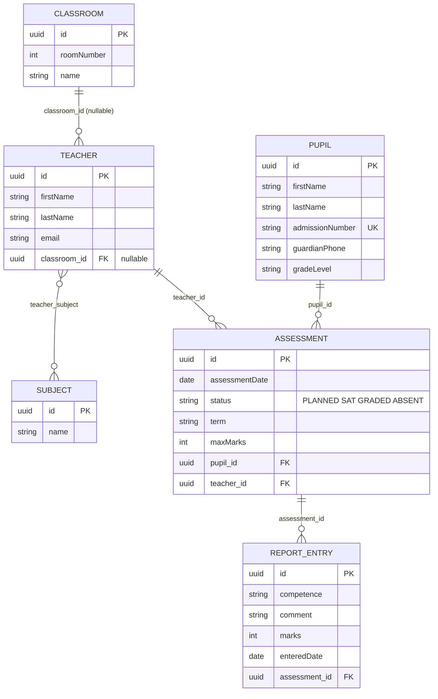
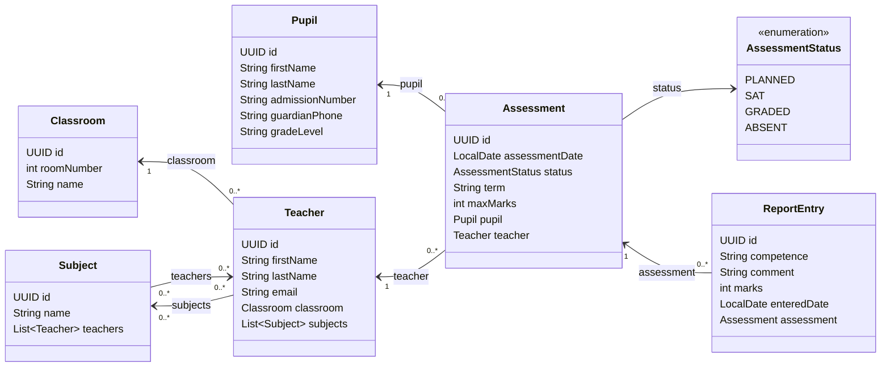
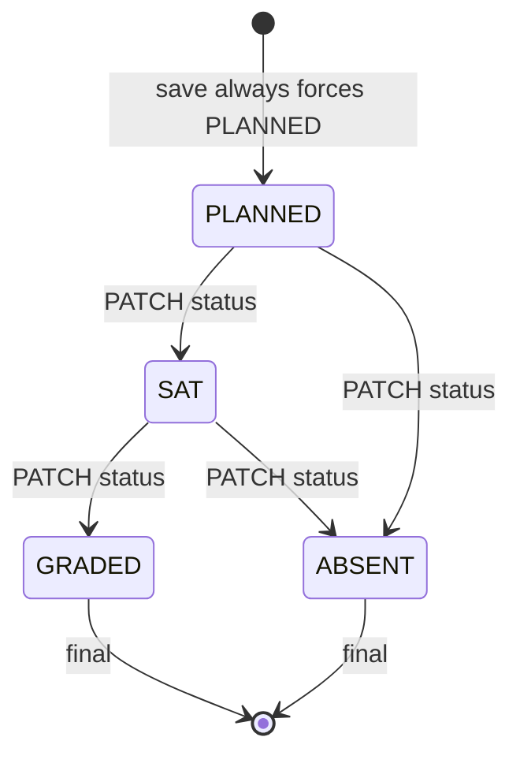

# Jericho School MIS — domain map

Planning document for the backend. Application code starts only after the instruction **start coding**.

A pupil sits an assessment set and marked by a teacher. A teacher is class teacher of one classroom and holds one or more subjects. An assessment moves `PLANNED → SAT → GRADED` or `ABSENT`. `GRADED` and `ABSENT` are final. Report entries exist only after an assessment is `GRADED`.

## Entity-relationship diagram

JPA shape from the paper. The foreign key sits on the “many” side. `teacher_subject` is the join table owned by `Teacher`.

`Classroom` has no teacher field. `Assessment` has no `List<ReportEntry>`. `Subject.teachers` exists in Java only so the many-to-many can be mapped from the other side, and it is `@JsonIgnore` so JSON does not loop.

Business rule D4 is stricter than the diagram: a classroom is held by at most one teacher. The schema still stores `classroom_id` on `teacher` as a nullable many-to-one.

## Class diagram

| Java field | Annotation | Table effect |
| --- | --- | --- |
| `Subject.teachers` | `@ManyToMany(mappedBy = "subjects")` `@JsonIgnore` | No extra column. Inverse side only. |
| `Teacher.classroom` | `@ManyToOne` `@JoinColumn(name = "classroom_id")` | Nullable FK. |
| `Teacher.subjects` | `@ManyToMany` `@JoinTable(name = "teacher_subject")` | Owning side. Add and save the teacher. |
| `Pupil.admissionNumber` | `unique = true` | Business key used by E2. |
| `Assessment.pupil` | `@ManyToOne` `@JoinColumn(name = "pupil_id")` | Required FK. |
| `Assessment.teacher` | `@ManyToOne` `@JoinColumn(name = "teacher_id")` | Required FK. |
| `Assessment.status` | `@Enumerated(EnumType.STRING)` | Stored as text, not ordinal. |
| `ReportEntry.assessment` | `@ManyToOne` `@JoinColumn(name = "assessment_id")` | No inverse list on `Assessment`. |

Layers per entity, same style as the clinic API: entity is the request and response body, repository, service returns `List`, `Optional`, or `String`, controller maps that string with if/else to an HTTP status. No DTOs. No try/catch. The bonus dashboard is the only `Map`.

## Assessment status

Any other move returns `400` with `Cannot change status from X to Y`. The general PUT update does not change status once D2 exists.

## Seed shape (entered through save endpoints after A2)

| Entity | Rows | Constraint the later queries need |
| --- | --- | --- |
| Subject | Mathematics, English, Kinyarwanda, Science | Science is held by nobody (C3) |
| Classroom | rooms 1, 2, 3, 4 | Room 4 has no teacher (C2) |
| Teacher | 3, each with a classroom | One teacher holds two subjects, one holds exactly one |
| Pupil | 5 | Two share last name `Umutoni`. Keep one `admissionNumber` such as `JS-2024-0112` |
| Assessment | 10, October and November 2026 | All four statuses. One pupil has at least 3. One teacher has two on `2026-10-20`, one of them `ABSENT`. At least 2 are `GRADED` |

October dates and non-`PLANNED` statuses must be saved **before** D1 and D2, because D1 rejects a past date and forces `PLANNED`, and D2 stops the general update from changing status.
